# Tank shop + OuiCoins

Proof shots and notes for the hull-paint cosmetics, the OuiCoins wallet and the
new Tank Shop. Screenshots were taken on this branch with Playwright; the
wallet balance and owned paints were seeded in `localStorage` before capture so
the shop's purchase states are visible. A fresh garage starts with **50**
OuiCoins, not the seeded demo balance shown in the shots.

## Before / after

**Master** — only the body/turret colour pickers, no currency, no shop entry:

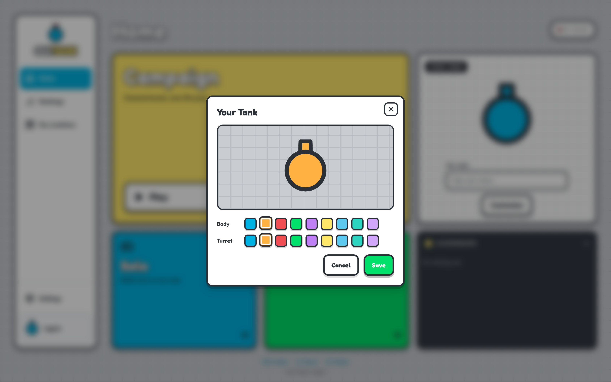

**This PR** — a paint row in the tank picker, a Shop button with the live
balance, and the same tank wearing Racing Stripes everywhere:

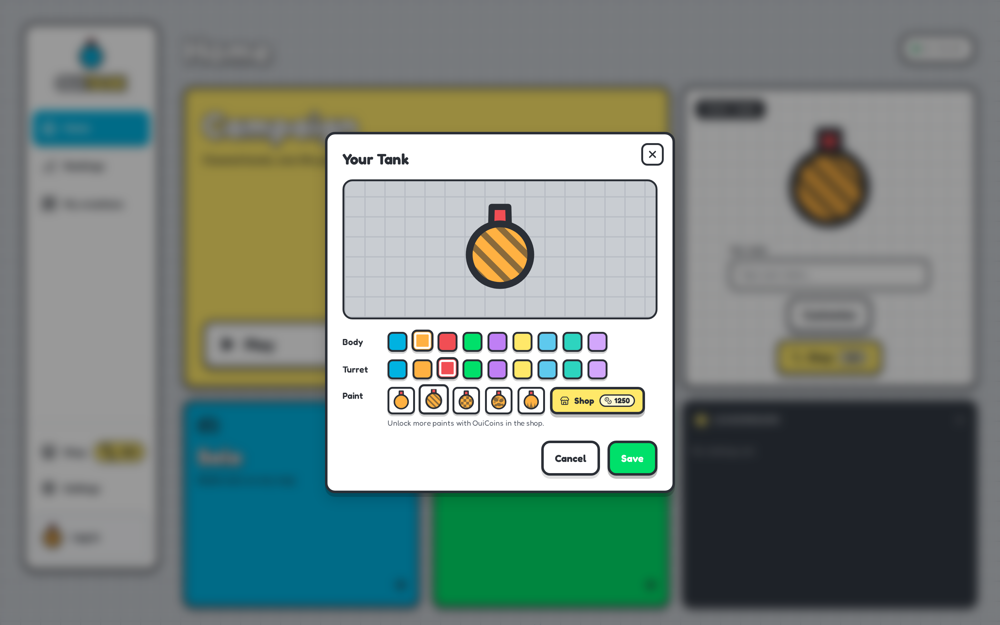

| Master home                        | This PR home                     |
| ---------------------------------- | -------------------------------- |
| 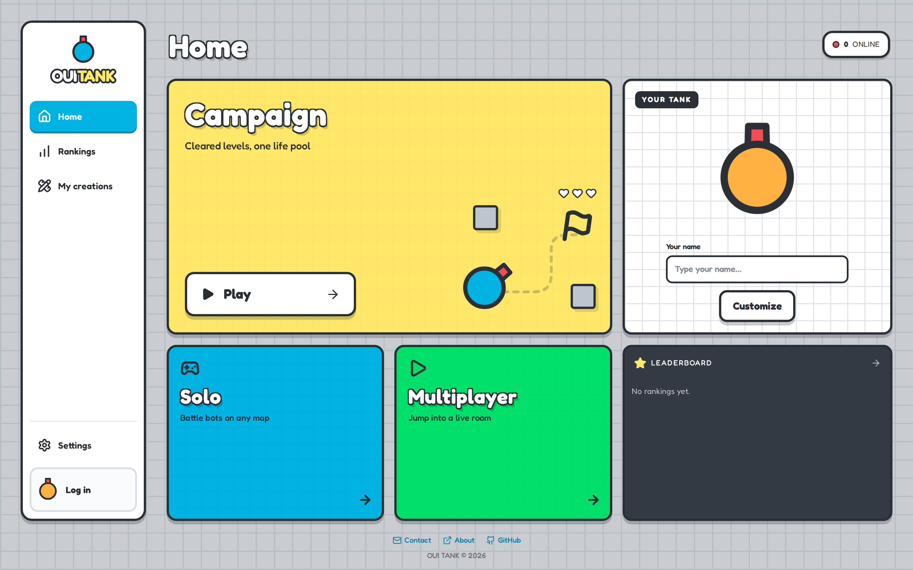 | 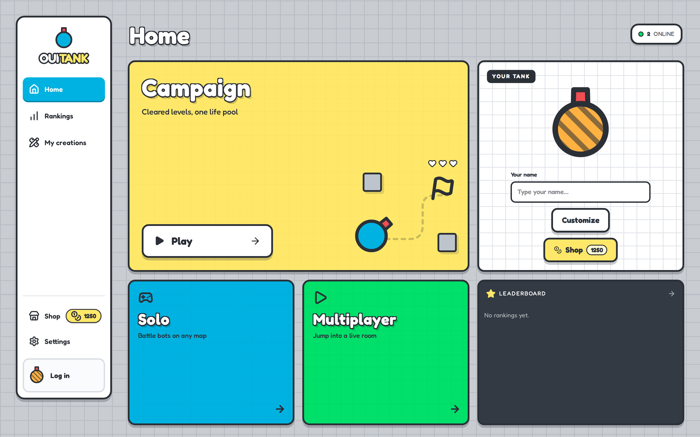 |

## The shop

All eight paints, previewed with the player's current body/turret and rendered
by the same `drawTank` routine as the arena.

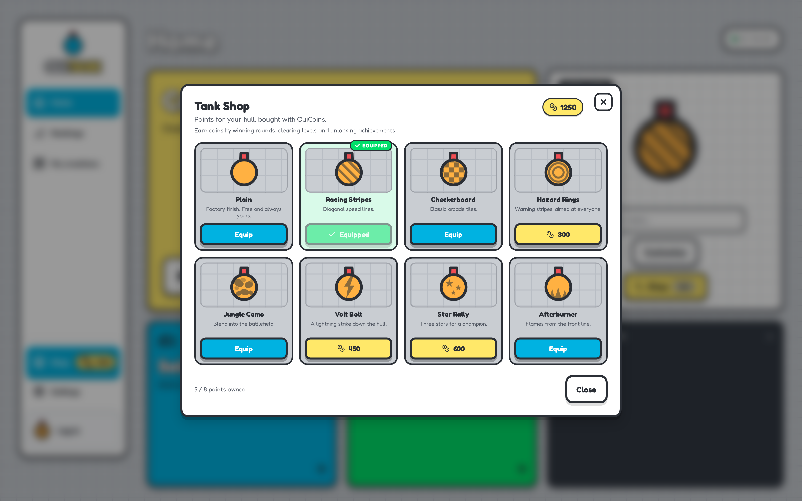

Buying auto-equips the paint, charges the wallet and updates every consumer
(sidebar chip, home tank, lobby, arena):

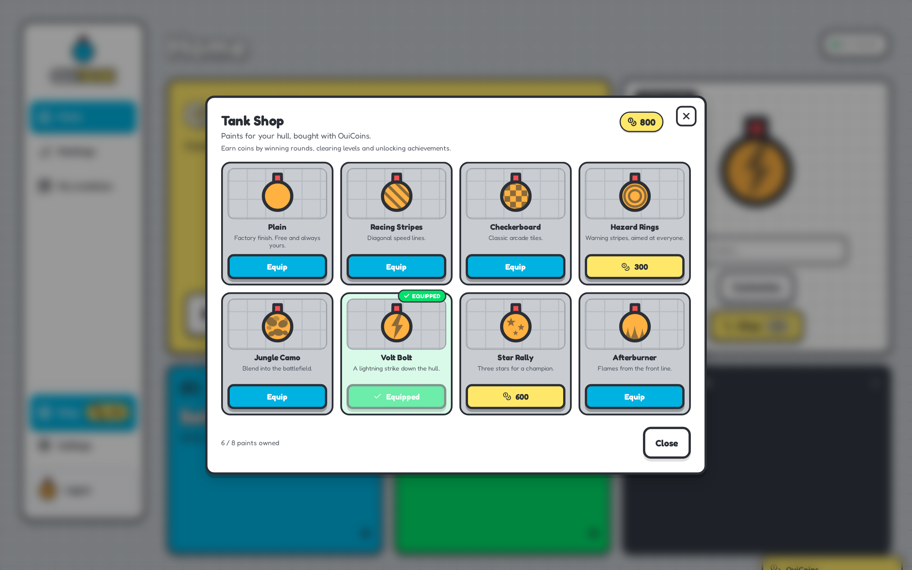

## In game

The paint travels through `play` → `Player` → tick snapshot → `Renderer`, so
other players see it too. Here the just-purchased Volt Bolt is on the local
tank in an editor test run:

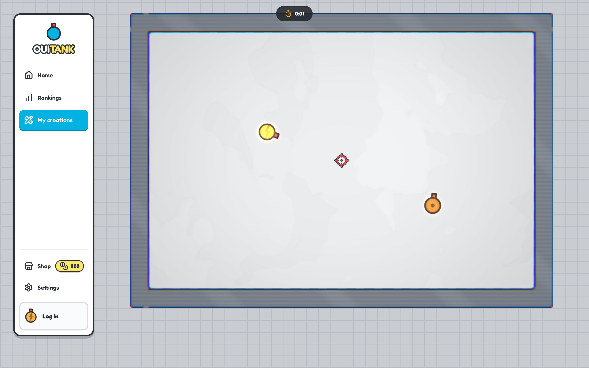

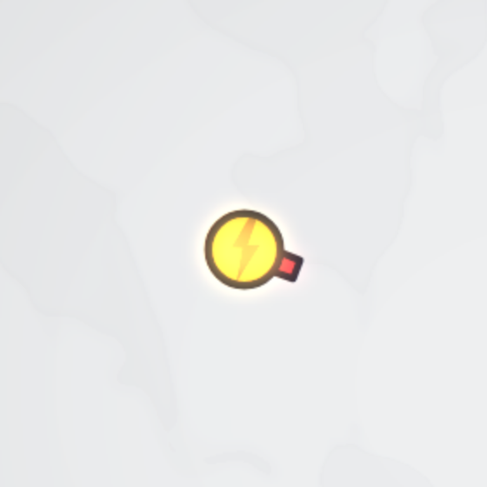

## What's included

| Paint          | Price (OuiCoins) | Pattern        |
| -------------- | ---------------: | -------------- |
| Plain          |             free | factory hull   |
| Racing Stripes |              200 | diagonal bands |
| Checkerboard   |              250 | arcade checker |
| Hazard Rings   |              300 | warning rings  |
| Jungle Camo    |              350 | two-tone blobs |
| Volt Bolt      |              450 | lightning bolt |
| Star Rally     |              600 | three stars    |
| Afterburner    |              750 | flames         |

Paint ids are stable keys shared by `localStorage`, the `play` socket event,
the `paintc` snapshot field and `lobby_state` members. Unknown ids (old clients,
hand-edited storage, a retired paint) resolve to the plain hull on both ends.
The patterns are drawn in a **contrast tone derived from the body colour**
(`contrastTone`), so they stay readable on every team hue — including the black
and white bot colours — and they drain with the existing hull ammo gauge.

### Earning coins

OuiCoins are earned from results the client already receives; all rules are
pure functions in `apps/web/src/lib/wallet.ts` and unit-tested:

| Source                                 | Coins |
| -------------------------------------- | ----: |
| Online kill                            |     1 |
| Online round win (incl. coop team win) |   +10 |
| Solo/campaign level kill               |     1 |
| Solo level clear                       |   +10 |
| Campaign level cleared (run payout)    |    +5 |
| Campaign run completed                 |   +25 |
| Achievement unlocked                   |    +5 |
| New player welcome balance             |    50 |

A typical 5-kill winning online round pays **15** OuiCoins, so the 200-coin
first paint takes roughly 13 wins; Afterburner (750) is a long-term goal. The
economy is deliberately slow — cosmetics are meant to be earned, not bought
after a couple of rounds.

Editor test runs never earn coins, so the level editor can't be used as a
money printer.

### Design note: local-first wallet

Cosmetics were already client-side (body/turret colours live in
`localStorage` and travel to the server with `play`), and solo/campaign play
works without an account. The wallet therefore lives beside them in a
versioned `garage` blob, validated on load (`parseGarage`): unknown paints are
dropped, `plain` is always owned, a stale equipped id resets to plain and a
negative balance clamps to 0. This avoids a DB migration and keeps anonymous /
itch players earning, at the cost of the balance not being authoritative for
competition — leaderboards and achievements remain server-side. A future
server-authoritative wallet can reuse the pure earn rules and the same paint
catalogue.

## Sidebar overflow fix

The OuiCoins pill next to the shop label spilled past the sidebar on narrow
desktop widths and longer locales (French "Boutique"). It now floats over the
right end of the row, outside the button's layout, so the row stays one line
and the balance stays inside the card. The pill is `aria-hidden` (the button's
label already includes the balance) and lets clicks through to the shop.

| Before — fr, 1440px                       | After — fr, 1440px                      |
| ----------------------------------------- | --------------------------------------- |
| 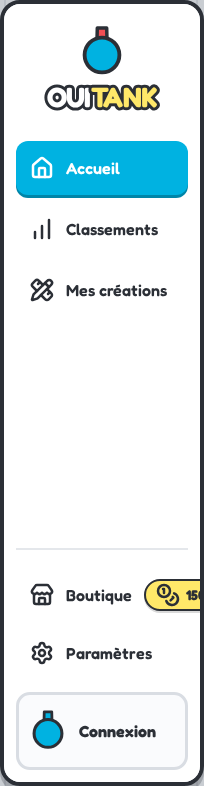 | 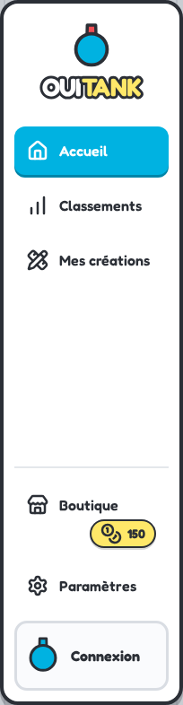 |

Narrow desktop (fr, 1100px):

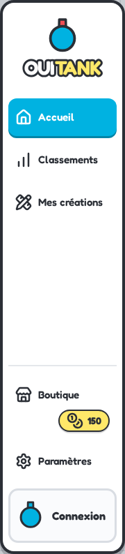

## Verification

- `pnpm test:unit` — web + shared Vitest suites.
- `TEST_DB_PORT=5434 pnpm test` — Jest (API) suite.
- `pnpm typecheck` — turbo typecheck (shared, db, api, web).
- `pnpm lint` — ESLint, no errors.
- `pnpm --filter @ouigame/web build` — production build.

The unit suite adds coverage for the wallet/economy rules, storage validation,
paint normalisation and the canvas paint overlay (`tankShape.test.ts`), plus the
updated tank-picker test.
